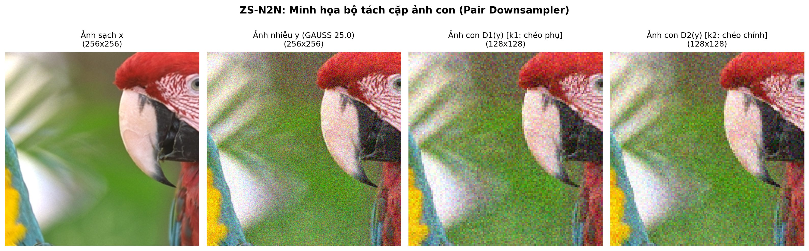
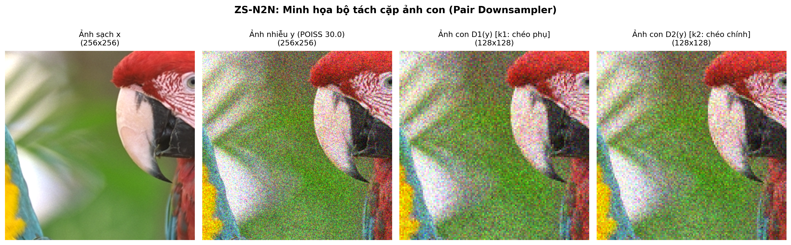

# BÁO CÁO PHẦN 1: ĐẦU VÀO VÀ BỘ TÁCH CẶP ẢNH
## Zero-Shot Noise2Noise (CVPR 2023)

- **Học phần**: Xử lý ảnh số
- **Thành viên thực hiện**: Người 1 — Đầu vào & Lý thuyết nền tảng
- **Mã nguồn phụ trách**: `src/input_utils.py` · `src/pair_downsampler.py` · `demos/demo_phan1.py`
- **Nhánh Git**: `phan1`

---

## I. TỔNG QUAN VÀ LÝ THUYẾT NỀN TẢNG

### 1. Vấn đề và động cơ (§0, §2)

Chất lượng khử nhiễu cao nhất hiện nay đến từ mạng học sâu được huấn luyện trên nhiều cặp ảnh nhiễu–sạch. Cách này có hai nhược điểm: thu thập dữ liệu tốn kém, và chất lượng tụt khi ảnh kiểm tra khác phân phối với ảnh huấn luyện.

Các phương pháp không dữ liệu (dataset-free) hiện có đều có điểm yếu:

| Phương pháp | Điểm yếu |
| :--- | :--- |
| BM3D, Anscombe | Cần biết trước mức nhiễu; BM3D chỉ hợp Gaussian |
| Deep Image Prior (DIP) | Chất lượng thường kém, phụ thuộc số vòng dừng sớm |
| Self2Self (S2S) | Rất tốn tính toán (~1,2 giờ GPU/ảnh 256×256), ảnh bị mịn quá do ensembling |
| Noise2Void | Không tổng quát tốt, kém khi nhiễu thấp |

**Giả thiết duy nhất của ZS-N2N về nhiễu**:
1. *Pixel-wise independent*: Nhiễu tại mỗi pixel độc lập với các pixel lân cận.
2. *Zero-mean*: Kỳ vọng toán học của nhiễu bằng 0 — $\mathbb{E}[e] = 0$.

---

### 2. Nền tảng Noise2Noise (§3, §4.1)

Noise2Noise (ICML 2018) chứng minh rằng: nếu có 2 ảnh chụp độc lập bị nhiễu của cùng một cảnh sạch $x$:

$$y_1 = x + e_1, \quad y_2 = x + e_2 \quad \text{(với } \mathbb{E}[e_1] = \mathbb{E}[e_2] = 0 \text{)}$$

thì (Công thức 1 trong bài báo):

$$\arg\min_{\theta} \mathbb{E}\|f_\theta(y_1) - x\|^2 = \arg\min_{\theta} \mathbb{E}\|f_\theta(y_1) - y_2\|^2$$

**Chứng minh phác thảo**: Vì $y_2 = x + e_2$, khai triển:

$$\mathbb{E}\|f_\theta(y_1) - y_2\|^2 = \mathbb{E}\|f_\theta(y_1) - x\|^2 \underbrace{- 2\,\mathbb{E}\langle f_\theta(y_1) - x,\, e_2\rangle}_{=\,0 \text{ (độc lập, kỳ vọng 0)}} + \underbrace{\mathbb{E}\|e_2\|^2}_{\text{hằng số}}$$

Hai bài toán có cùng nghiệm. Không cần ảnh sạch, chỉ cần **2 ảnh nhiễu độc lập của cùng cảnh**.

**Hạn chế**: Thực tế hiếm khi chụp được 2 bức ảnh nhiễu độc lập của cùng một cảnh động.

---

## II. BỘ TÁCH CẶP ẢNH CON — PAIR DOWNSAMPLER (§4.2, §4.3)

### 1. Ý tưởng cốt lõi (§4.2)

Trong ảnh tự nhiên:
- Các pixel **lân cận** có độ sáng và màu sắc rất gần nhau (tính tương quan không gian).
- Nhiễu tại mỗi pixel **hoàn toàn độc lập** (pixel-wise independent).

**Giải pháp**: Từ 1 ảnh nhiễu duy nhất $y$, tách các pixel lân cận thành 2 nhóm theo 2 đường chéo của mỗi khối $2 \times 2$. Hai nhóm này có **cùng tín hiệu cảnh** nhưng **nhiễu độc lập nhau** — đóng vai trò như cặp ảnh $y_1, y_2$ trong Noise2Noise.

### 2. Thiết kế Kernel (§4.3)

Với mỗi khối $2 \times 2$: $\begin{bmatrix} a & b \\ c & d \end{bmatrix}$

$$k_1 = \begin{bmatrix} 0 & 0.5 \\ 0.5 & 0 \end{bmatrix} \Rightarrow D_1(y) = \frac{b+c}{2} \quad \text{(đường chéo phụ)}$$

$$k_2 = \begin{bmatrix} 0.5 & 0 \\ 0 & 0.5 \end{bmatrix} \Rightarrow D_2(y) = \frac{a+d}{2} \quad \text{(đường chéo chính)}$$

Thực hiện bằng `F.conv2d` với `stride=2, groups=C` (xử lý riêng từng kênh màu).

**4 tính chất quan trọng**:
1. **Không mất pixel**: Mỗi pixel dùng đúng 1 lần trong 1 ảnh con — khác với Noise2Fast vốn bỏ bớt pixel.
2. **Nhiễu độc lập**: Hai ảnh con dùng các pixel khác nhau hoàn toàn trong ô $2 \times 2$.
3. **Giảm phương sai nhiễu**: Trung bình 2 pixel nhiễu độc lập cùng phương sai $\sigma^2$ → phương sai còn $\sigma^2/2$.
4. **Kernel cố định**: $k_1, k_2$ không học được (`requires_grad=False`).

---

## III. HIỆN THỰC MÃ NGUỒN

### 1. `src/input_utils.py` — Nạp ảnh và tạo nhiễu

```python
def add_noise(clean, noise_type="gauss", noise_level=25.0):
    """Thêm nhiễu Gaussian hoặc Poisson vào ảnh sạch."""
    if noise_type == "gauss":
        sigma = noise_level / 255.0
        noisy = clean + torch.randn_like(clean) * sigma   # y = x + N(0, σ²)
    elif noise_type == "poiss":
        noisy = torch.poisson(clean * noise_level) / noise_level
    return noisy.clamp(0.0, 1.0)
```

| Loại nhiễu | Công thức | Tham số |
| :--- | :--- | :--- |
| Gaussian | $y = x + \mathcal{N}(0, \sigma^2)$ | `noise_level` = $\sigma \times 255$; $\sigma$ càng lớn nhiễu càng nặng |
| Poisson | $y = \text{Poisson}(x \cdot \lambda) / \lambda$ | `noise_level` = $\lambda$; $\lambda$ càng nhỏ nhiễu càng nặng |

### 2. `src/pair_downsampler.py` — Bộ tách cặp ảnh

```python
def pair_downsampler(img):
    """Tạo D1=(b+c)/2 và D2=(a+d)/2 trên từng khối 2×2, từng kênh."""
    channels = img.shape[1]
    kernel_d1 = img.new_tensor([[[[0.0, 0.5], [0.5, 0.0]]]]).repeat(channels, 1, 1, 1)
    kernel_d2 = img.new_tensor([[[[0.5, 0.0], [0.0, 0.5]]]]).repeat(channels, 1, 1, 1)
    d1 = F.conv2d(img, kernel_d1, stride=2, groups=channels)   # [N, C, H/2, W/2]
    d2 = F.conv2d(img, kernel_d2, stride=2, groups=channels)   # [N, C, H/2, W/2]
    return d1, d2
```

> **Khác biệt so với Notebook gốc (Colab)**: Phiên bản gốc dùng biến toàn cục `device` ẩn bên ngoài hàm. Phiên bản này dùng `img.new_tensor(...)` để kernel tự động nằm cùng thiết bị với ảnh đầu vào (CPU hoặc GPU), không cần truyền `device` thêm.

---

## IV. KẾT QUẢ THỰC NGHIỆM

### 1. Chạy Demo — Nhiễu Gaussian (σ = 25/255)

**Lệnh chạy:**
```powershell
python -m demos.demo_phan1 --image "data/reference/kodim23_256.png" --noise-type gauss --noise-level 25
```

**Kết quả terminal:**
```
1. KÍCH THƯỚC VÀ THÔNG SỐ CÁC TENSOR:
- Ảnh nhiễu y     : shape=[1, 3, 256, 256], min=0.0000, max=1.0000
- Ảnh con D1(y)   : shape=[1, 3, 128, 128], min=0.0000, max=1.0000
- Ảnh con D2(y)   : shape=[1, 3, 128, 128], min=0.0000, max=1.0000

2. PHÂN TÍCH TÍNH CHẤT HAI ẢNH CON D1(y) VÀ D2(y):
- MSE giữa D1 và D2: 0.009515
  -> D1 và D2 có chung tín hiệu nền nhưng hoa văn nhiễu độc lập.
  -> Mỗi ảnh con giảm một nửa chiều cao và chiều rộng (H/2, W/2).
```

**Hình ảnh trực quan:**



*Hình 1: Từ trái sang phải: Ảnh sạch x (256×256) | Ảnh nhiễu y với Gaussian σ=25/255 (256×256) | Ảnh con D1(y) [đường chéo phụ] (128×128) | Ảnh con D2(y) [đường chéo chính] (128×128). MSE(D1, D2) = 0.009515.*

---

### 2. Chạy Demo — Nhiễu Poisson (λ = 30)

**Lệnh chạy:**
```powershell
python -m demos.demo_phan1 --image "data/reference/kodim23_256.png" --noise-type poiss --noise-level 30
```

**Kết quả terminal:**
```
- Ảnh nhiễu y     : shape=[1, 3, 256, 256], min=0.0000, max=1.0000
- Ảnh con D1(y)   : shape=[1, 3, 128, 128], min=0.0000, max=1.0000
- Ảnh con D2(y)   : shape=[1, 3, 128, 128], min=0.0000, max=1.0000
- MSE giữa D1 và D2: 0.014871
```

**Hình ảnh trực quan:**



*Hình 2: Cùng bố cục với Hình 1 nhưng dùng nhiễu Poisson λ=30. MSE(D1, D2) = 0.014871 lớn hơn so với Gaussian (nhiễu Poisson phụ thuộc cường độ pixel nên hạt nhiễu to và không đều hơn).*

---

### 3. Nhận xét từ kết quả

| Thông số | Gaussian (σ=25) | Poisson (λ=30) |
| :--- | :---: | :---: |
| Kích thước ảnh đầu vào $y$ | 256 × 256 | 256 × 256 |
| Kích thước $D_1(y)$ và $D_2(y)$ | 128 × 128 | 128 × 128 |
| MSE giữa $D_1$ và $D_2$ | **0.009515** | **0.014871** |
| Tỷ lệ giảm kích thước | 1/2 mỗi chiều | 1/2 mỗi chiều |

**Nhận xét**:
- MSE > 0 ở cả 2 trường hợp xác nhận nhiễu ở $D_1$ và $D_2$ thực sự **khác nhau và độc lập**, thỏa mãn tiền đề của Noise2Noise.
- Nhiễu Poisson cho MSE cao hơn vì hạt nhiễu phụ thuộc cường độ sáng (vùng tối hạt to hơn).
- Nội dung hình ảnh (con vẹt) được bảo toàn trọn vẹn trong cả 2 ảnh con, không pixel nào bị bỏ sót.

---

## V. KIỂM THỬ TỰ ĐỘNG (UNIT TEST)

**Lệnh chạy:**
```powershell
python -m unittest -v tests.test_zsn2n
```

**Kết quả:**
```
test_01_parameter_count                      ... ok  (22,275 tham số đúng chuẩn)
test_02_network_preserves_shape              ... ok  (CNN giữ nguyên kích thước ảnh)
test_03_pair_downsampler_kernels_and_shape   ... ok  (kernel D1/D2 đúng, H/2 × W/2)
test_04_loss_components_match_formulas       ... ok  (Loss khớp công thức bài báo)
test_05_total_is_sum_of_components           ... ok  (Total = Res + Cons)
test_06_backpropagation_computes_gradients   ... ok  (Gradient CNN hữu hạn, khác 0)
test_07_add_noise_gaussian_and_poisson       ... ok  (Nhiễu Gauss & Poisson đúng [0,1])

Ran 7 tests in 0.038s — OK
```

> **Các test liên quan trực tiếp đến Người 1**:
> - `test_03`: Xác nhận kernel $k_1, k_2$ cho đúng giá trị theo công thức và kích thước $D_1, D_2 = H/2 \times W/2$.
> - `test_07`: Xác nhận `add_noise` cho ảnh nhiễu trong dải $[0, 1]$ với cả 2 loại nhiễu.

---

## VI. LUỒNG DỮ LIỆU TRONG DỰ ÁN NHÓM

```
[NGƯỜI 1 — PHẦN NÀY]
data/reference/kodim23_256.png  ──→  add_noise()  ──→  y (ảnh nhiễu)
                                                            │
                                                     pair_downsampler()
                                                       /           \
                                                  D1(y)           D2(y)
                                               [128×128]        [128×128]
                                                   │                │
                                        ───────────┴────────────────┘
                                                   ▼
                                     [NGƯỜI 2: Tính Residual Loss & Consistency Loss]
                                                   ▼
                                     [NGƯỜI 3: Huấn luyện 3000 vòng, đo PSNR]
```

Ảnh sạch tham chiếu `data/reference/kodim23_256.png` **không tham gia huấn luyện**, chỉ dành cho Người 3 đo PSNR sau khi mô hình đã khử nhiễu xong.
